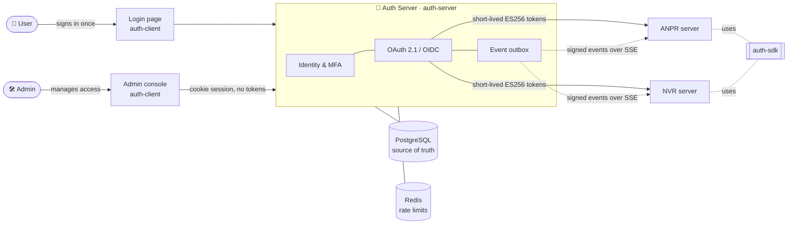

<div align="center">

# 🔑 Auth Server

**One sign-in, one source of truth for access, and revocations that reach every app in seconds.**

The central identity and access server for a family of applications: ANPR, NVR and whatever comes next.


[Features](#-features) ·
[How it works](#-how-it-works) ·
[Quick start](#-quick-start) ·
[Connect an app](#-connect-your-application) ·
[Docs](#-documentation)

</div>

---

## ✨ Why

Every application used to keep its own users, its own passwords and its own idea of who may do what. Disabling
someone meant visiting every system and hoping nothing was missed.

The Auth Server replaces that with **one place**:

- 🔐 **Users sign in once** and reach every connected app.
- 🧭 **Administrators manage every app's permissions and roles** in one console.
- ⚡ **Changes land everywhere within seconds.** Disable a user, remove a role or end a session, and every app
  refuses the old token, with no polling and no restarts.
- 🛰️ **Apps don't depend on it per request.** They check tokens locally, so a short Auth Server outage doesn't
  take them down.

---

## 🚀 Features

| | |
|---|---|
| **Single sign-on** | One hosted login page for every app, silent sign-in, independent logins per app and device, safe across browser tabs |
| **Two-step sign-in** | Authenticator apps with **QR-code setup**, plus **security keys and passkeys** (WebAuthn) |
| **Central access control** | Applications → permissions → roles → users, with up to 1,024 permissions per app packed into one compact token claim |
| **Instant revocation** | Signed events streamed to every downstream server over SSE, from a transactional outbox: gapless, replayable, acknowledged |
| **Standards first** | OAuth 2.1, OpenID Connect, PKCE (S256), ES256 JWTs, JWKS, RFC 7009 revocation, RFC 8693 token exchange |
| **Service accounts** | Client credentials for backend services, and safe on-behalf-of calls between services |
| **Signing keys** | Automatic rotation, keys published before use, one-click revocation of a leaked key |
| **Audit trail** | Every change recorded in the same transaction, and the database refuses edits or deletes |
| **Admin console** | Dashboard, applications, users, clients, signing keys, downstream sync health, audit log |
| **Self-service** | Every user manages their password, sessions, authenticator app and security keys |
| **Hardened** | Argon2id, encrypted secrets at rest, rate limits that fail closed, CSRF-safe console, no tokens in the browser |
| **Python SDK** | Drop-in FastAPI dependencies: `require_perm("vehicle.read")` and you're done |

👉 The full, detailed list (every feature, small to big) is in **[docs/FEATURES.md](docs/FEATURES.md)**.

---

## 🧩 How it works



1. **The user signs in once.** The app sends them to the hosted login page, and they come back with a
   10-minute access token made only for that app.
2. **The app checks the token itself:** signature against cached public keys, plus audience, expiry and
   permissions. No call to the Auth Server.
3. **When access changes,** the Auth Server writes the change and a signed event in one transaction and
   streams it to every affected app, which drops the old token within seconds.
4. **If the stream is ever down,** the short token lifetime is the guaranteed upper limit.

The deep dive is in [auth-server/docs/ARCHITECTURE.md](auth-server/docs/ARCHITECTURE.md).

---

## 📁 Repository

```
Auth-Server/
├── auth-server/   FastAPI server: identity, OAuth/OIDC, access control, events, audit
├── auth-client/   React app: hosted login page, admin console, My account
├── sdk/           Python SDK for downstream servers (ANPR, NVR, ...)
└── docs/          Features, project structure, client plan
```

| Folder | Stack | Read more |
|---|---|---|
| [`auth-server/`](auth-server/) | Python 3.13 · FastAPI · Tortoise ORM + Aerich · PostgreSQL · Redis · joserfc · Argon2 · pyotp · webauthn | [README](auth-server/README.md) |
| [`auth-client/`](auth-client/) | React 19 · TypeScript · Vite · Tailwind CSS v4 · TanStack Router & Query · Radix | [README](auth-client/README.md) |
| [`sdk/`](sdk/) | Python · httpx · joserfc · optional FastAPI | [README](sdk/README.md) |

---

## ⚡ Quick start

### Prerequisites

- **Python 3.13** and **Node.js 22**
- **PostgreSQL** and **Redis**, running locally

### 1. Start the server

```bash
cd auth-server
python -m venv .venv
.venv\Scripts\activate                     # Windows (macOS/Linux: source .venv/bin/activate)
pip install -r requirements.txt

copy .env.example .env                     # macOS/Linux: cp
```

Fill in `.env`:

| Setting | Value |
|---|---|
| `DB_PASSWORD` | your Postgres password |
| `MASTER_KEY` | `python -c "import base64,os;print(base64.urlsafe_b64encode(os.urandom(32)).decode())"` |
| `REDIS_URL` | e.g. `redis://127.0.0.1:6379/0` |
| `ISSUER` | `http://localhost:5181` (the address browsers use) |
| `ENVIRONMENT` | `development` |

Then create the database, the first administrator, and run:

```bash
createdb auth
createdb auth_test                         # for the test suite
aerich upgrade                             # apply migrations
py cli.py create-admin --username admin --email you@example.com
py main.py                                 # API on http://localhost:8000
```

> There is **no default password**. `create-admin` asks for one, and works only once.

### 2. Start the web app

```bash
cd auth-client
npm install
npm run dev                                # http://localhost:5181
```

Open **http://localhost:5181** and sign in with the administrator you just created. 🎉

The dev server proxies `/v1`, `/oauth`, `/bff`, `/.well-known` and `/health` to the API, so the browser sees one
origin.

---

## 🔌 Connect your application

**In the console:**

1. Under **Applications**, create your app (for example `ANPR`) with its permissions and roles.
2. Under **Clients**, create a **confidential** client for it with the scopes `events.read` and
   `permissions.read`. Copy the secret, which is shown only once.
3. Under **Users**, give people roles in the app.

**In your FastAPI server:**

```bash
pip install -e path/to/Auth-Server/sdk
```

```python
from contextlib import asynccontextmanager
from fastapi import Depends, FastAPI
from auth_sdk import AuthSDK, Principal

auth = AuthSDK(
    issuer="http://localhost:5181",          # exactly the server's ISSUER
    app_key="ANPR",
    client_id="anpr-api",
    client_secret="...",
    state_path="/var/lib/anpr/auth-state.json",
)

@asynccontextmanager
async def lifespan(_: FastAPI):
    await auth.start()                       # keys, permission map, snapshot, live events
    yield
    await auth.stop()

app = FastAPI(lifespan=lifespan)

@app.get("/vehicles")
async def vehicles(user: Principal = Depends(auth.require_perm("vehicle.read"))):
    return {"hello": user.sub}
```

Your server now trusts the Auth Server's tokens, applies revocations within seconds, and shows up on the
console's **Downstream sync** page.

Not on Python? The protocol is plain HTTP + SSE + JWT. See
**[auth-server/docs/INTEGRATION.md](auth-server/docs/INTEGRATION.md)**.

---

## 📚 Documentation

| Document | What's inside |
|---|---|
| [docs/FEATURES.md](docs/FEATURES.md) | Every feature, small to big |
| [auth-server/docs/ARCHITECTURE.md](auth-server/docs/ARCHITECTURE.md) | How it's built and why: tokens, keys, revocation, failure behaviour |
| [auth-server/docs/API.md](auth-server/docs/API.md) | Every endpoint, request, response and error code |
| [auth-server/docs/INTEGRATION.md](auth-server/docs/INTEGRATION.md) | Step-by-step guide for downstream servers |
| [docs/PROJECT_STRUCTURE.md](docs/PROJECT_STRUCTURE.md) | The folder structure and coding conventions |
| [docs/CLIENT_IMPLEMENTATION_PLAN.md](docs/CLIENT_IMPLEMENTATION_PLAN.md) | How the web app was planned and built |

Interactive API docs are served at `http://localhost:8000/docs` outside production.

---

## 🧪 Testing

| Part | Command | Covers |
|---|---|---|
| Server | `cd auth-server && pytest` | 311 tests against a real PostgreSQL test database |
| Web app | `cd auth-client && npm test` | 36 unit and component tests (Vitest) |
| End to end | `cd auth-client && npm run e2e` | Real browser (Edge) against a real server on a throwaway database |
| SDK | `cd sdk && python -m unittest discover -s tests` | 21 tests against a fake Auth Server signing with real keys |

Quality gates: `npm run lint` (oxlint), `npm run build` (type check + bundle), and
`python -m app.security.policy_audit` (fails if any route has no explicit access rule).

---

## 🛡️ Security at a glance

- **Passwords** hashed with Argon2id; **secrets at rest** (signing keys, TOTP secrets, console tokens) encrypted
  with AES-GCM.
- **Tokens** are ES256, audience-bound and short-lived. Refresh tokens rotate, and a stolen one is detected.
- **The browser never holds a token.** The console uses an HttpOnly cookie plus a CSRF header.
- **Fail closed everywhere:** unknown routes are denied, an unsynced downstream server refuses requests, and
  Redis being down blocks sign-in instead of skipping rate limits.
- **The server refuses to start** with weak settings: a missing `MASTER_KEY`, wildcard CORS, or in production a
  default database password or a non-https issuer.

Found a vulnerability? Please report it privately to the maintainers rather than opening a public issue.

---

## 🗺️ Roadmap

- [x] Server: identity, MFA, OAuth 2.1 / OIDC, access control, events, audit
- [x] Web app: login page, admin console, self-service
- [x] Python SDK for downstream servers
- [ ] Docker images and nginx config for production
- [ ] Move NVR and ANPR onto the SDK
- [ ] Consent screen for third-party clients

---

## 📄 License

Released under the **GNU General Public License v3.0**. See [LICENSE](LICENSE).
