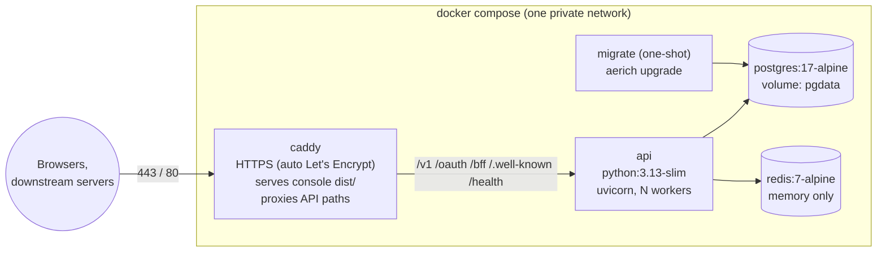

# Deployment Plan

**Goal:** one command brings up the whole Auth Server (API, web console, PostgreSQL and Redis) with HTTPS,
and it uses as little RAM as possible.

**Status:** Docker Compose option built and tested. See [deploy/README.md](../deploy/README.md). The native option (section 7) is not built.

---

## 1. Is Docker too heavy?

It depends on the operating system.

| Host | Docker overhead | Verdict |
|---|---|---|
| **Linux server** | Containers are ordinary processes. The `dockerd` daemon adds about 50–100 MB, and nothing else | ✅ Light. Use Docker |
| **Windows / macOS (Docker Desktop)** | Runs a whole Linux VM (WSL2). It often reserves 1–2 GB or more | ❌ Heavy. This is probably what you've seen |

So the RAM cost people complain about comes from **Docker Desktop**, not from containers themselves.

**Recommendation:**

1. **Production on a Linux server:** use Docker Compose. It's the simplest to install, upgrade, back up
   and move.
2. **Production on Windows, or a very small machine:** use the **native** setup in section 7. It needs the
   same configuration and no Docker.
3. **Development on Windows:** keep running the API and Vite natively, as you do now. Optionally run only
   Postgres and Redis in Docker.

### Expected RAM

| Part | RAM |
|---|---|
| PostgreSQL 17 (tuned small) | 80–200 MB |
| Redis (no persistence, 64 MB cap) | 5–15 MB |
| API: 2 uvicorn workers | 2 × 70–120 MB |
| Caddy (TLS + serving the console) | 20–40 MB |
| **Total** | **about 300–500 MB** |

This fits on a 1 GB VPS, and comfortably on 2 GB.

---

## 2. Target layout



- **Only Caddy is exposed** (80 and 443). The API, Postgres and Redis are reachable only on the private network.
- **Same origin:** the console and the API share one domain, exactly as the Vite proxy does in development.
  So there's no CORS setup, and the cookies keep working.

### Why Caddy, not nginx

| | Caddy | nginx |
|---|---|---|
| HTTPS | Automatic (Let's Encrypt, renewal included) | certbot plus a cron job |
| SSE | `flush_interval -1`, one line | `proxy_buffering off`, timeouts, `X-Accel-Buffering` |
| Config | About 15 lines | About 60 lines |
| RAM | About 20–40 MB | About 5–10 MB |

nginx stays a fine alternative if you already run it. Section 6 includes its config.

---

## 3. Files to add

```
Auth-Server/
├── deploy/
│   ├── docker-compose.yml        production stack
│   ├── docker-compose.dev.yml    only postgres + redis, for local development
│   ├── Caddyfile                 TLS, static console, API proxy
│   ├── .env.example              everything an operator sets
│   ├── backup.sh                 pg_dump to ./backups, keeps the last N
│   └── README.md                 install, first admin, upgrade, backup, restore
├── auth-server/
│   ├── Dockerfile                multi-stage, non-root, no build tools in the final image
│   ├── .dockerignore
│   └── requirements-dev.txt      pytest etc. moved out of requirements.txt
└── auth-client/
    ├── Dockerfile                node build → caddy image holding dist/
    └── .dockerignore
```

---

## 4. Each piece

### 4.1 API image (`auth-server/Dockerfile`)

- **Base:** `python:3.13-slim`, multi-stage. Wheels are built in the first stage, and only the installed packages
  are copied to the final one. Target size is about 150 MB.
- **Dependencies:** split `requirements.txt` so the image doesn't carry pytest, httpx or python-dotenv
  (they move to `requirements-dev.txt`).
- **Security:** runs as a non-root user, with a read-only root filesystem where possible, and no secrets
  baked in.
- **Command:**
  ```
  uvicorn main:app --host 0.0.0.0 --port 8000 --workers ${WORKERS:-2}
          --proxy-headers --forwarded-allow-ips ${FORWARDED_ALLOW_IPS}
  ```
  - **Several workers are safe:** the event hub and background jobs already handle several processes
    (LISTEN/NOTIFY and advisory locks).
- **Healthcheck:** `GET /health/ready`.

### 4.2 Migrations (`migrate` service)

- **What it is:** the same image, run once with `aerich upgrade`.
- **Ordering:** `api` has `depends_on: migrate: condition: service_completed_successfully`, so the schema is
  always current before traffic arrives.
- **Why separate:** migrations never run from several workers at once.

### 4.3 Console + Caddy (`auth-client/Dockerfile`)

- **Stage 1:** `node:22-alpine`, which runs `npm ci && npm run build` and produces `dist/`.
- **Stage 2:** `caddy:2-alpine`, holding `dist/` and the `Caddyfile`.
- **Caddyfile, in outline:**
  ```
  {$DOMAIN} {
      encode zstd gzip
      @api path /v1/* /oauth/* /bff/* /.well-known/* /health/*
      handle @api {
          reverse_proxy api:8000 {
              flush_interval -1          # SSE must not be buffered
          }
      }
      handle {
          root * /srv
          try_files {path} /index.html  # SPA routes like /login, /users
          file_server
      }
      header /assets/* Cache-Control "public, max-age=31536000, immutable"
  }
  ```
- **Local or LAN use without a public domain:** `DOMAIN=localhost` or an IP, and Caddy issues an internal
  certificate.

### 4.4 PostgreSQL

- **Image:** `postgres:17-alpine`, with data in the named volume `pgdata`.
- **Tuned small:** `shared_buffers=64MB`, `max_connections=50`, `work_mem=4MB`.
- **Healthcheck:** `pg_isready`.
- **Not published to the host.**

### 4.5 Redis

- **Image:** `redis:7-alpine`, run with `--save "" --appendonly no --maxmemory 64mb --maxmemory-policy noeviction`.
- **No volume:** it holds only counters and challenges that are fine to lose (see ARCHITECTURE.md).
  `noeviction` ensures it never silently drops a live challenge.

### 4.6 Compose details

- **Restarts:** `restart: unless-stopped` on every long-running service.
- **Memory caps:** a limit per service (`mem_limit`), so one runaway can't take the host.
- **Logging:** the `json-file` driver with `max-size: 10m, max-file: 3`, so logs can't fill the disk.
- **Configuration:** one `.env` file next to `docker-compose.yml`, shown below.

```
DOMAIN=auth.example.com
ISSUER=https://auth.example.com
ENVIRONMENT=production
MASTER_KEY=<32 random bytes, base64url>        # back this up separately
DB_PASSWORD=<random>
WORKERS=2
FORWARDED_ALLOW_IPS=*                          # only Caddy can reach the api container
```

---

## 5. Operator experience (the goal)

```bash
# install
git clone ... && cd Auth-Server/deploy
cp .env.example .env            # set DOMAIN, MASTER_KEY, DB_PASSWORD
docker compose up -d --build

# first administrator
docker compose run --rm api python cli.py create-admin --username shah --email you@example.com

# upgrade
git pull && docker compose up -d --build     # migrate runs automatically before api

# backup / restore
./backup.sh                                   # pg_dump to backups/auth-YYYYMMDD.sql.gz
docker compose exec -T postgres psql -U postgres auth < backup.sql

# logs / status
docker compose logs -f api
docker compose ps
```

---

## 6. Things to fix or decide while building

| # | Item | Why |
|---|---|---|
| 1 | Split dev dependencies out of `requirements.txt` | Smaller image, smaller attack surface |
| 2 | `ISSUER` must be the public `https://` URL | Production refuses http. Tokens, cookies and passkeys are tied to it |
| 3 | Passkeys tie to the domain | Changing `DOMAIN` later makes existing passkeys stop working |
| 4 | `FORWARDED_ALLOW_IPS` set to the Caddy network | Rate limits must see the real client IP, not Caddy's |
| 5 | **Restore the real password rules** (12 chars, username check) | They are still on the temporary values in server and client |
| 6 | Fix the stale `export-openapi` default path in `cli.py` | Points at the old `../client` folder |
| 7 | Document `MASTER_KEY` backup | Losing it makes signing keys and TOTP secrets unreadable; a DB backup alone isn't enough |
| 8 | nginx alternative config in `deploy/README.md` | For hosts that already run nginx (`proxy_buffering off`, `proxy_read_timeout 1h` on `/v1/events/`) |
| 9 | Test with `--workers 4` and two SDK clients on different workers | Multi-worker SSE is designed for but not yet tested live |

---

## 7. Without Docker (native, lowest RAM)

The same layout with no containers, for Windows servers or tiny machines:

| Part | Linux | Windows |
|---|---|---|
| PostgreSQL | distro package | official installer (Windows service) |
| Redis | distro package | **Memurai** (Redis-compatible, runs as a service) |
| API | venv + `systemd` unit running uvicorn | venv + **NSSM** service running uvicorn |
| Console + TLS | Caddy (single binary, systemd) serving `dist/` | Caddy (single binary, NSSM service) |

- **Saving:** about 100 MB less than Docker on Linux, and about 1–2 GB less than Docker Desktop on Windows.
- **Cost:** upgrades are manual (`git pull`, `pip install`, `aerich upgrade`, rebuild `dist/`, restart).
- **Scripts:** `deploy/native/` could hold an `install` script and the service files to make this nearly as easy.

---

## 8. Build order

| Phase | Work | Check |
|---|---|---|
| 1 | Split requirements; API `Dockerfile` + `.dockerignore` | Image builds; `/health/live` answers |
| 2 | `docker-compose.dev.yml` (postgres + redis) | Local dev works against it |
| 3 | Console `Dockerfile` + `Caddyfile` | SPA routes load; API paths proxy; SSE streams through Caddy |
| 4 | Production `docker-compose.yml` + `migrate` + `.env.example` | Fresh `up -d` → create-admin → console login works |
| 5 | Multi-worker test: 4 workers, SDK clients, role change | Every SDK gets the event |
| 6 | `backup.sh`, `deploy/README.md`, nginx alternative | Backup and restore round-trip on a scratch volume |
| 7 | *(optional)* native install scripts | Same checks without Docker |
