# How It Works: Flow Diagrams

This document shows each moving part of the Auth Server as a step-by-step flow. The diagrams use Mermaid,
which GitHub, GitLab and VS Code (with a Mermaid extension) draw automatically.

| # | Flow | Who is involved |
|---|---|---|
| 1 | [The big picture](#1-the-big-picture) | Everything |
| 2 | [Sign-in page (password, TOTP, passkey)](#2-sign-in-page-password-totp-passkey) | User, login page, Auth Server |
| 3 | [Admin console (auth-client) login](#3-admin-console-auth-client-login) | Admin, console, BFF |
| 4 | [Downstream web or desktop app login](#4-downstream-web-or-desktop-app-login-pkce) | User, your app, Auth Server |
| 5 | [Refresh and logout](#5-refresh-token-rotation-and-logout) | Your app, Auth Server |
| 6 | [Downstream server: SDK startup and sync](#6-downstream-server-sdk-startup-and-sync) | SDK, Auth Server |
| 7 | [Downstream server: checking a request](#7-downstream-server-checking-a-request) | User's app, your server, SDK |
| 8 | [A change reaching every server](#8-a-change-reaching-every-downstream-server) | Admin, Auth Server, SDKs |
| 9 | [Server to server](#9-server-to-server-service-tokens-and-token-exchange) | Two downstream servers |
| 10 | [Members and roles API](#10-members-and-roles-api) | Downstream server, SDK |
| 11 | [Signing key rotation](#11-signing-key-rotation-and-revocation) | Auth Server, SDKs |
| 12 | [Running several replicas](#12-running-several-replicas) | Load balancer, replicas, Postgres |

---

## 1. The big picture

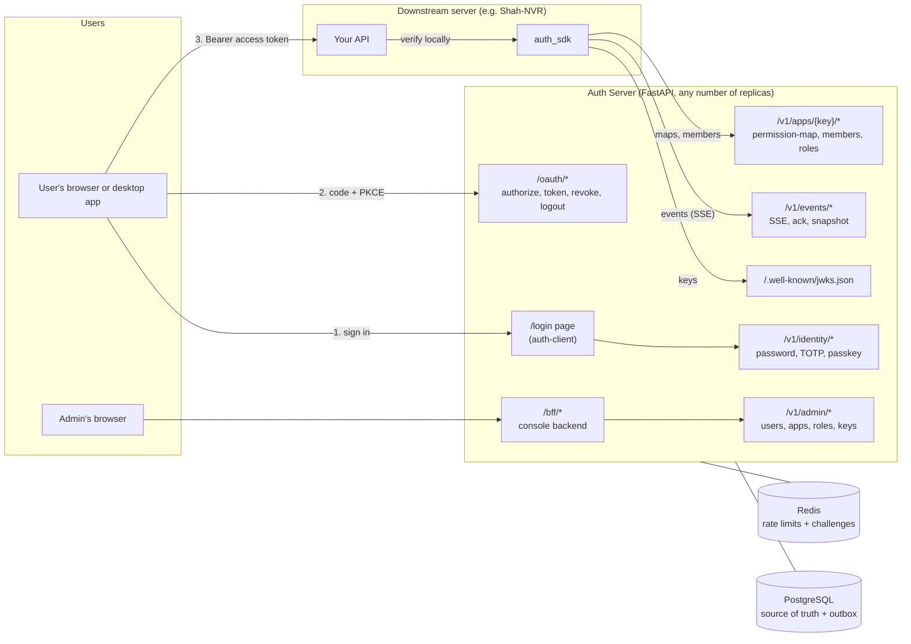

**The core idea:**
- The Auth Server issues short-lived signed tokens (10 minutes).
- Downstream servers verify them **locally** with the public keys; there is no call per request.
- Changes such as a lost role, a disabled user or a logout are **pushed** to every downstream server over SSE
  within about a second.

---

## 2. Sign-in page (password, TOTP, passkey)

Every login (the console, a downstream web app, a desktop app) ends up on this one page. The result is always
the same: an `auth_sso` cookie, then a redirect back to `/oauth/authorize`.

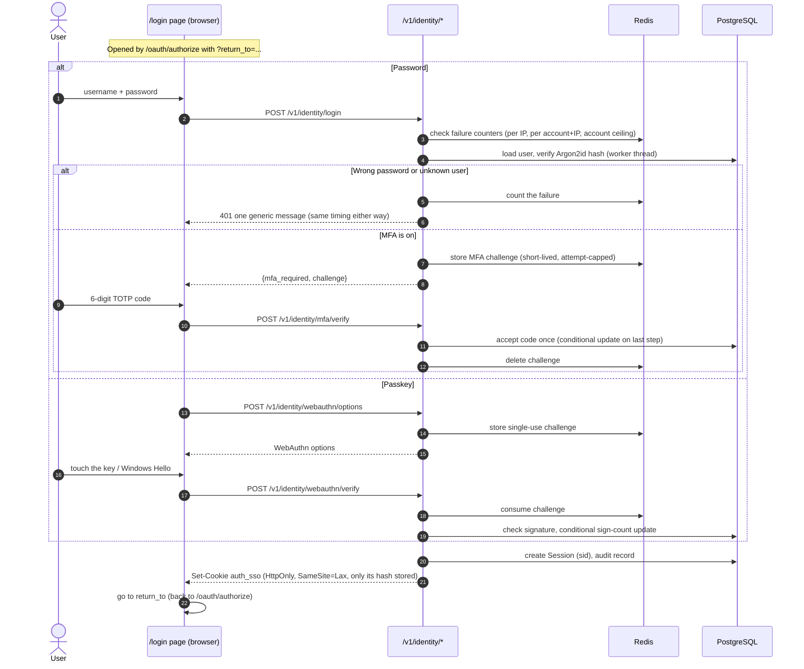

**Notes:**
- **Redis down:** login and MFA return 503. This is deliberate, because without the counters it can't stop guessing.
- **Lockouts:** only failures count, and a stranger can't lock someone out from a different address.

---

## 3. Admin console (auth-client) login

The console is a normal OAuth client called `auth-console`, but **the browser never sees a token**. The BFF
(backend-for-frontend) keeps the tokens on the server.

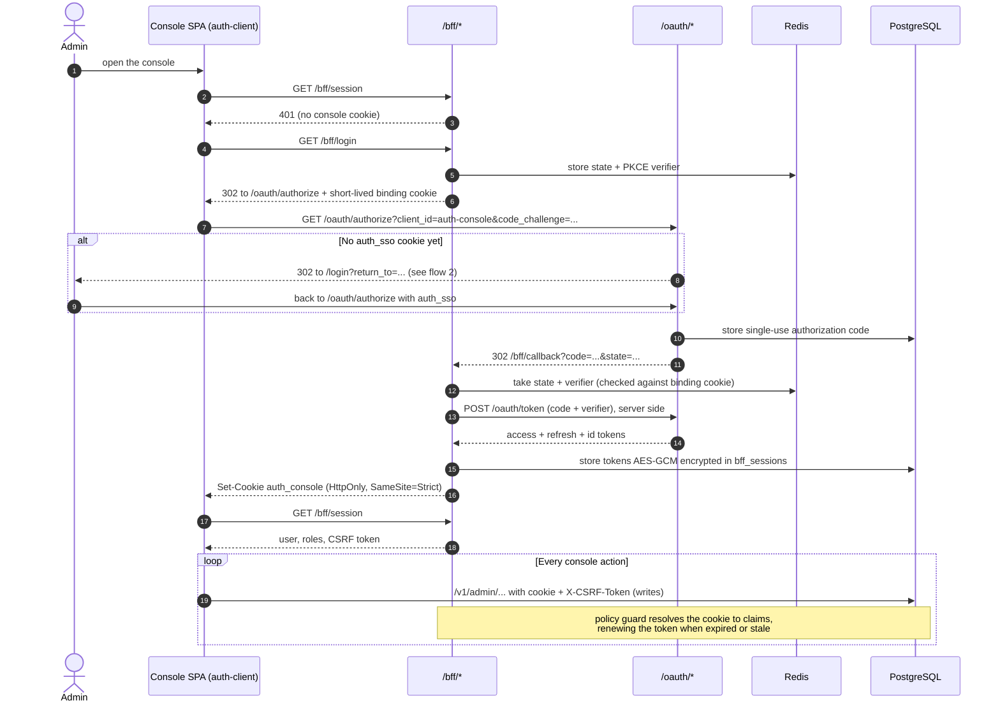

**Notes:**
- **Role changes apply immediately:** if an admin loses the Admin role, the next call sees the new token
  version and is refused.
- **Logout:** `POST /bff/logout` ends the console session and the SSO session behind it.

---

## 4. Downstream web or desktop app login (PKCE)

This applies to a **Browser app** client (public, no secret), for example SNVR-web, or the desktop app with a
loopback redirect `http://127.0.0.1:<port>/callback`.

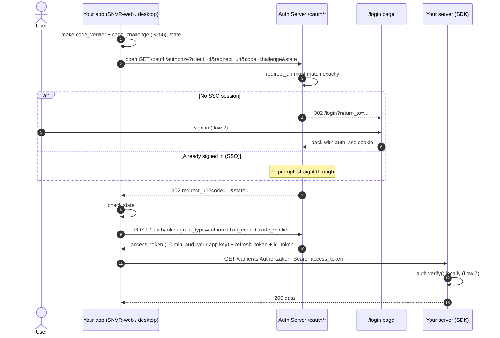

**Notes:**
- **Single sign-on:** once the user is signed in to one app, other apps get through without a password, because they share
  the `auth_sso` cookie.
- **Codes:** a code is single-use. If it's used twice, everything the code issued is revoked.
- **Public clients have no secret:** PKCE proves that the app redeeming the code is the one that started the
  login.
- **User details:** get the signed-in user's name and email from `GET /oauth/userinfo`, not from the token.

---

## 5. Refresh token rotation and logout

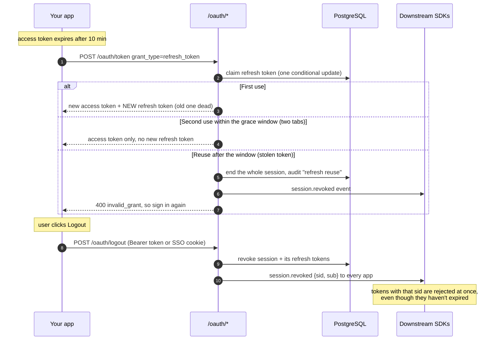

---

## 6. Downstream server: SDK startup and sync

This is what `auth_sdk` does in the background after `await auth.start()`.

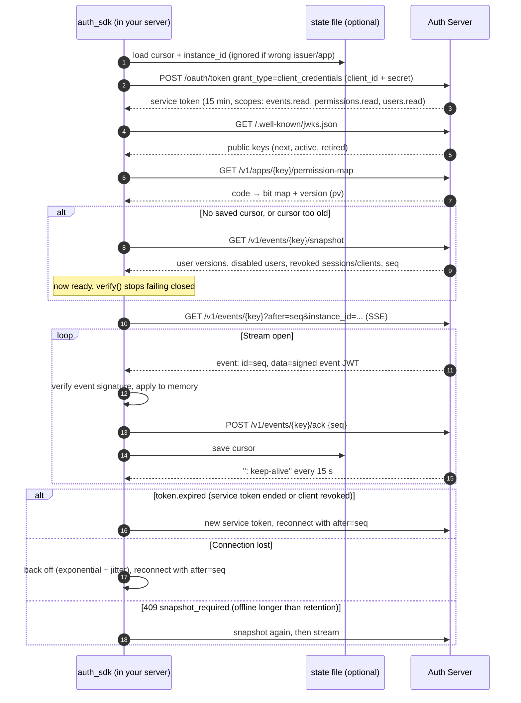

**What each event does in the SDK's memory:**

| Event | SDK reaction |
|---|---|
| `user.access_changed` / `user.disabled` | Raise the minimum token `ver` for that user / mark them disabled |
| `session.revoked` | Add the `sid` to the revoked set |
| `client.revoked` | Reject tokens that client issued before `revoked_at` |
| `key.rotated` | Reload JWKS; drop the key at once if `revoked` |
| `permissions.changed` | Reload the permission map |
| `members.changed` | Fire `on_change` callbacks (refresh your members/roles cache) |

The console's **Downstream sync** page shows each instance's cursor and lag, using the ack position.

---

## 7. Downstream server: checking a request

`auth.verify(token)` or `Depends(auth.require_perm("camera.view"))`. **No network call per request.**

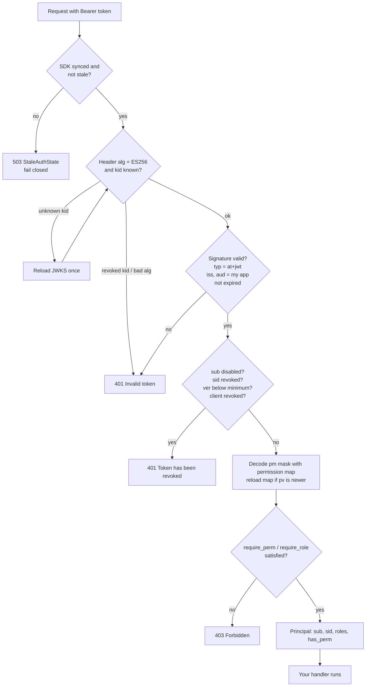

---

## 8. A change reaching every downstream server

Example: an admin removes the *Operator* role from Vikas in SNVR.

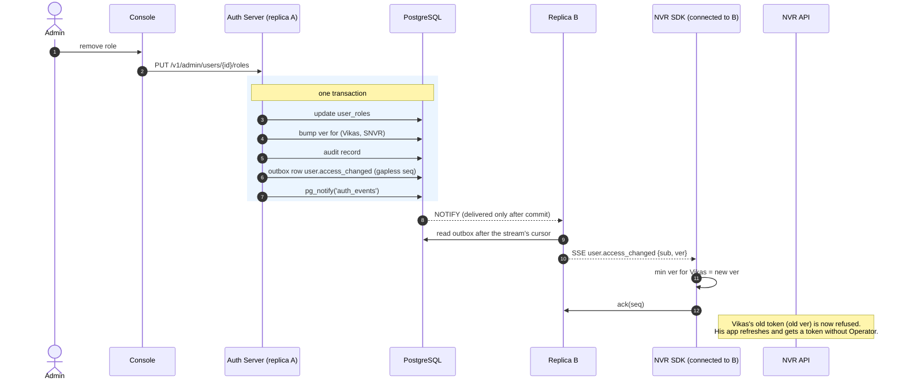

**Guarantees:**
- **Never out of step:** the change and its event are committed together, so neither can exist without the other.
- **Never lost:** a downstream server that was offline replays from its cursor on reconnect.
- **Worst case:** if the stream is down, old tokens still die within 10 minutes when they expire.

---

## 9. Server to server: service tokens and token exchange

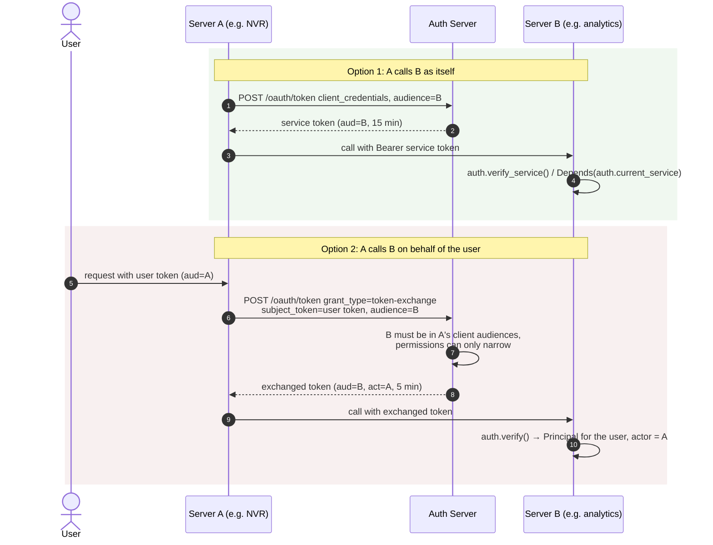

---

## 10. Members and roles API

This flow is for pages like NVR's Access page: "give these cameras to this user or this role". The client needs the
`users.read` scope.

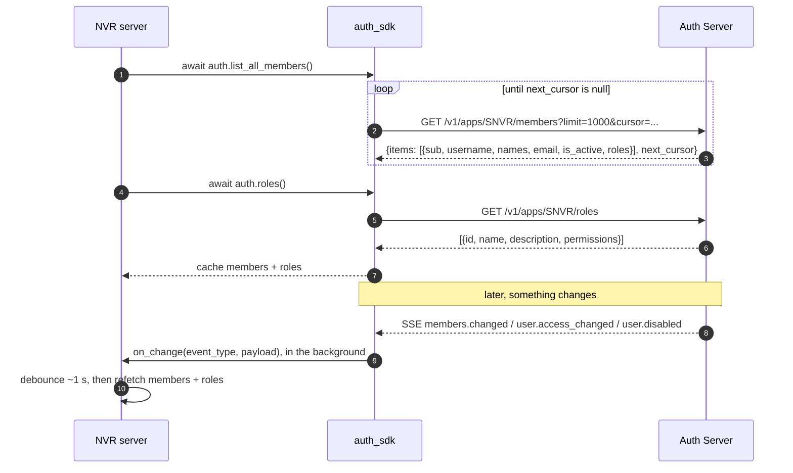

**Rules:**
- **User grants:** store them by `sub`.
- **Role grants:** store them by role `id`, never the name.
- **On a request:** map `principal.roles` names to ids through the cached roles list.

---

## 11. Signing key rotation and revocation

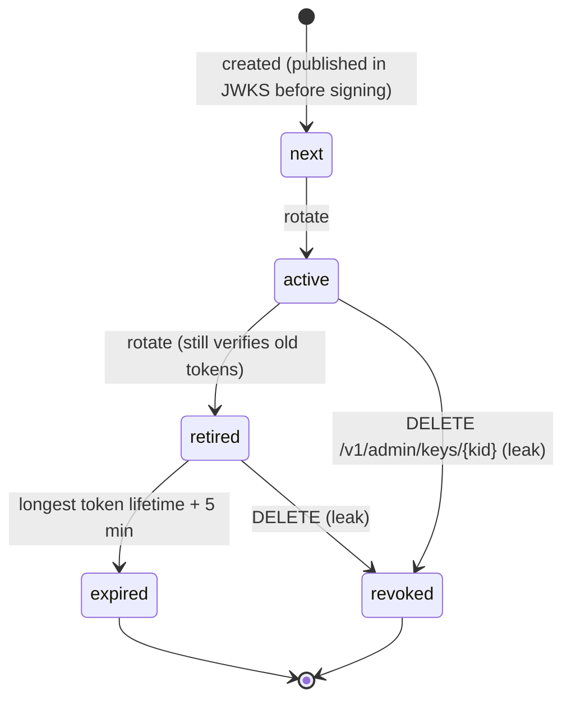

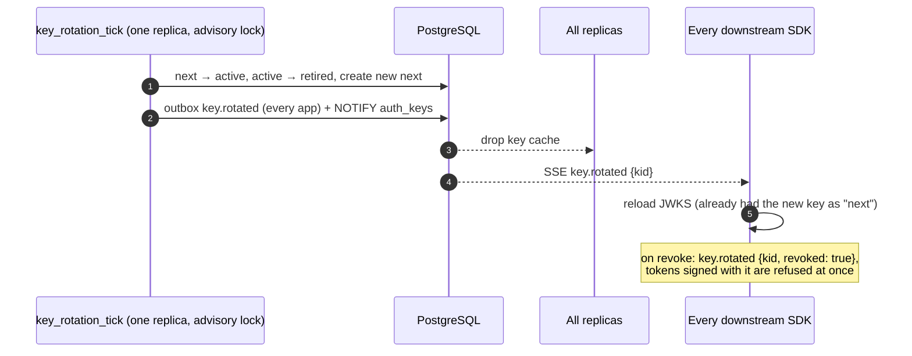

---

## 12. Running several replicas

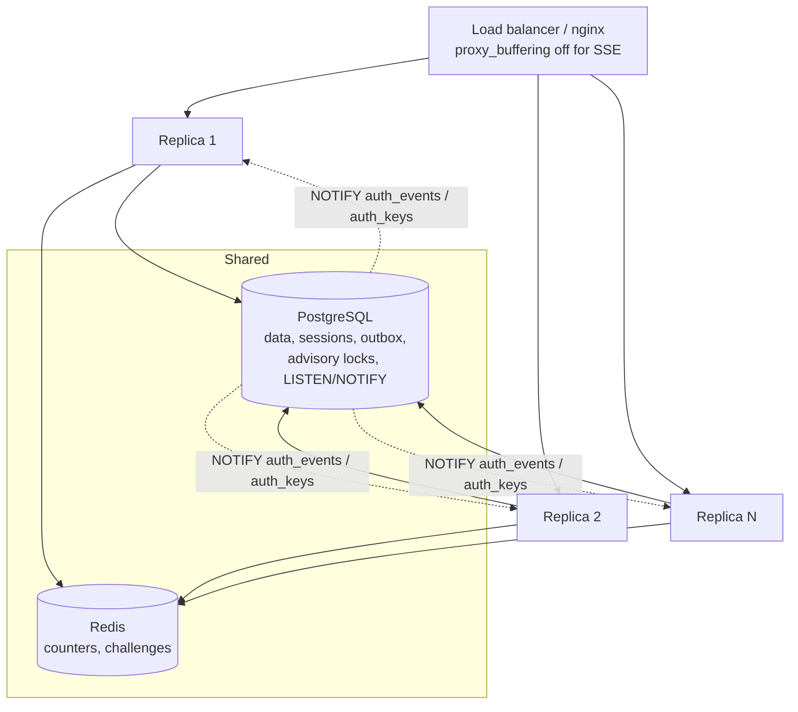

| Concern | How it's handled |
|---|---|
| A change made on replica 1, a stream open on replica 3 | Every replica LISTENs; NOTIFY wakes all of them, and streams read the outbox |
| A missed NOTIFY | Streams also poll the outbox every 5 s |
| Background jobs | Postgres advisory lock, so only one replica runs each job per tick |
| Signing key cache | `NOTIFY auth_keys` clears it on every replica |
| Sessions and login state | Postgres and Redis, so no sticky sessions are needed |
| A downstream server reconnects to another replica | Its cursor is in Postgres, so it resumes from the same seq |

---

## Related documents

| Document | What it covers |
|---|---|
| `auth-server/docs/ARCHITECTURE.md` | Design decisions and failure behaviour |
| `auth-server/docs/API.md` | Every endpoint |
| `auth-server/docs/INTEGRATION.md` | Step-by-step guide to connecting a downstream app |
| `sdk/README.md` | SDK reference |
| `docs/FEATURES.md` | Full feature list |
